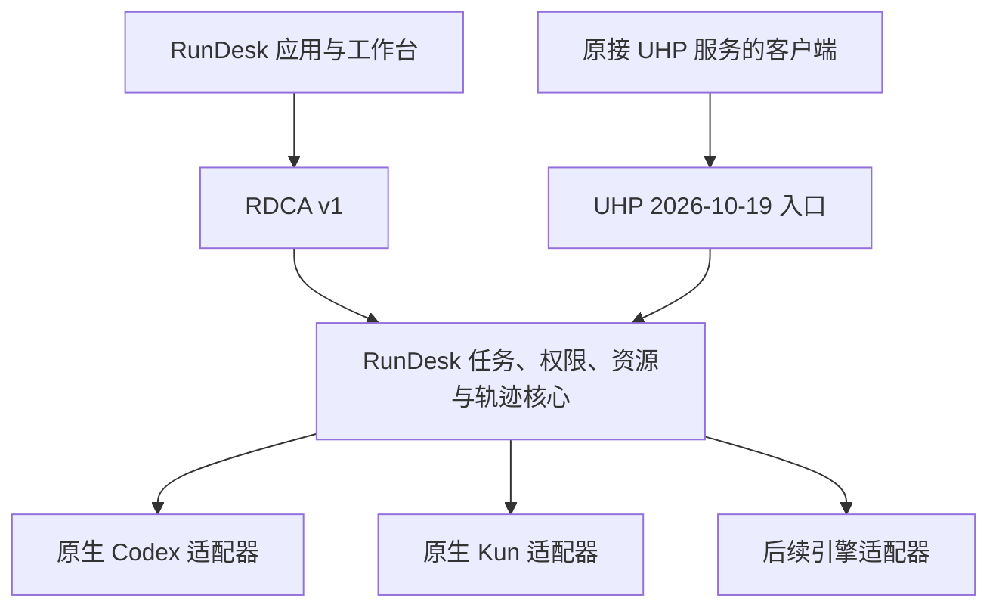

# RunDesk Control API 与 UHP 兼容方向

状态：2026-10-20 更新。RunDesk v0.52.0 重构版已加入固定 UHP `2026-10-19` 的 `/v1` 入口；当前覆盖范围、后端差异和验证边界见 [UHP 服务](UHP.md)，不声明完整 UHP conformant。

## 独立定位与命名

RunDesk 是独立的 Go 控制平台与调试工作台，不以 HarnessRouter 服务、源码、数据库或运行时为依赖。自身 API 命名为 **RunDesk Control API（RDCA）**，当前版本为 RDCA v1，继续使用 `/api/v1`。这里的 v1 是 RunDesk 自有契约版本，不是 UHP 的版本。

RDCA 覆盖任务、会话、文件、事件、资源配置、执行环境与调试，并继续遵守各接口的身份、作用域和归属限制。现有契约见 [API v1](API-V1.md)；本次命名不改变路径、请求字段、响应结构或错误与幂等语义。

[UHP](https://unifiedharnessprotocol.org/) 是固定版本的线协议参考；[HarnessRouter](https://github.com/HarnessRouter/harnessrouter) 是设计参考及迁移客户端的原服务，不是 RunDesk 的第三个必需执行后端。RunDesk 在 `/v1` 提供 UHP 入口，完整兼容仍需补足已记录的语义差异并完成真实客户端回归。

## 一个运行核心，两个服务入口

UHP 入口中的 RunDesk 扮演 server；应用是 client。向下如何驱动引擎由 RunDesk 的原生适配器负责。采用 UHP 不要求向 HarnessRouter 发请求，也不把 UHP 当作 Kun 的内部 JSONL 协议。

两个入口复用同一套任务调度、身份与归属校验、执行状态和轨迹存储。幂等提交通过公共任务准入事务保存协议回执；等待和重试响应仍按各自协议实现。协议层负责验证、映射和输出，不能分别维护两套运行循环或终态权威。幂等命名空间仍需绑定调用身份、协议入口和规范化请求；相同 Key 不表示不同协议中的请求自动等价。

任务提交回执、会话中的一次执行、UHP response 和原生引擎 turn 并非名称替换。实施时需明确 ID 映射、接收与终态、续接、并发、取消竞争和错误语义，并以契约测试验证。已有 RDCA 客户端继续使用自身语义，不为 UHP 改写历史回执。

## 公共资源与调试

Skills、MCP、插件、权限、工作区与原生状态的身份、版本及作用域绑定属于 RunDesk 平台服务。v0.52.0 重构版已提供 `resource.Catalog/Bindings/Resolver`、`PolicyService` 和实际运行路径接入。清单投影现有权威配置，Skills/MCP/plugin 标记声明来源与不支持项；不把目录声明当成已加载清单，不公开凭据或主机路径。每次准入记录资源元数据，原生执行仍由独立后端转换配置并回报实际状态。

资源内容版本冻结、统一目录写入管理和所有后端的插件装载仍需后续扩展。当前清单不是完整配置备份；Codex 原生配置与 Skill 目录可由外部工具修改，其版本明确标记为 live。见 [资源契约](RESOURCE-CONTRACTS.md)。

来自 UHP 入口的新运行生成 RunDesk 原生任务与轨迹关联；经过授权，可在工作台或 RDCA 调试接口中查看其工具参数、结果、错误和实际采集到的模型交互。UHP 标准输出与 RunDesk 调试扩展分别表达，不要求标准客户端理解 Kun 专属操作。

调试能力以实际引擎、当前状态、授权和已记录证据为准。没有模型正文采集就不能显示完整模型请求；没有断点、单步、快照或分叉能力就不能宣称支持。Codex HTTP 观测继续是默认关闭的原协议直通采集，不转变为统一模型 API。

当前 Kun 仍拥有模型与工具循环、journal、检查点和分叉。把 Kun 进一步拆成决策内核、由 RunDesk 执行动作，是独立的后续设计，不是 UHP 的既有要求，也不随本次命名迁移。每次运行只有一个循环负责人；将来若拆分，运行分叉需协调决策状态与平台工作区、记录和副作用边界。

## 客户端迁移目标

目标是让原接 HarnessRouter 的业务客户端，在固定 UHP 版本和能力范围内改接 RunDesk，并使用 RunDesk 调试该入口创建的新运行。基础迁移应尽量收敛为服务地址、RunDesk 签发的凭据，以及目标 harness、model 和资源绑定配置；是否无需改业务调用代码，以真实客户端回归为准。

协议兼容不等于服务数据可搬迁。旧服务的 session/response/file ID、原生线程、凭据、幂等回执、工作区和已安装资源不会自动在 RunDesk 生效。保留历史与继续旧执行需另做显式导出、导入及格式与引擎校验；未采集或未导出的轨迹无法补回。HarnessRouter 专属管理接口、私有扩展和控制台功能也不自动属于 UHP 兼容范围。

## 实施阶段与验收

| 阶段 | 工作 | 完成依据 |
| --- | --- | --- |
| 0：独立契约 | 定名 RDCA，保持 v1 契约，修正依赖和协议方向的说明 | 文档与 OpenAPI 名称一致 |
| 1：公共平台服务 | 独立后端模块、任务接口、资源身份/绑定/解析、策略服务、任务检查和引用存储 | v0.52.0 重构版落实这些边界；完整资源写入管理与内容冻结另行扩展 |
| 2：UHP 运行入口 | 已加入 `/v1`、公共同会话提交、原生日志投影、文件和会话检查 | 固定 `2026-10-19`；逐项记录官方套件与内部测试结果，原生后端差异见 [UHP](UHP.md) |
| 3：完整兼容与迁移 | 实现目标版本 Full 必需能力，逐项声明可选能力，回归真实下游客户端 | 发布对应版本/class 的完整一致性报告及客户端迁移记录；UHP 新运行在工作台可调试 |

完整兼容始终指明协议版本、class 和可选能力，不表示永久兼容后续草案或所有厂商扩展。实施时需核对规范正文、Schema、指南与测试的一致性，不根据滚动示例臆测端点。只通过局部检查时，不宣传完整兼容。

## 来源与许可

本次根据固定版本公开规范实现独立 Go 适配层，官方套件从外部固定 checkout 运行，不复制上游 Schema 或实现。UHP 官方将规范与代码置于 Apache-2.0；今后采用或修改其材料时，应记录固定版本、文件、许可证、适用 NOTICE 与修改。官方将 UHP 兼容名称声明与一致性测试绑定，声明之前需完成对应验证。来源与当前分发范围见 [UPSTREAM](UPSTREAM.md)。

- [UHP Architecture](https://unifiedharnessprotocol.org/spec/architecture)：完整 harness、server/client 和兼容等级。
- [UHP Tasks](https://unifiedharnessprotocol.org/spec/tasks)：任务运行与 harness 内部工具执行。
- [UHP Governance](https://unifiedharnessprotocol.org/governance)：规范许可证及兼容名称声明。
- [UHP Conformance](https://unifiedharnessprotocol.org/conformance)：一致性验证及覆盖范围。
