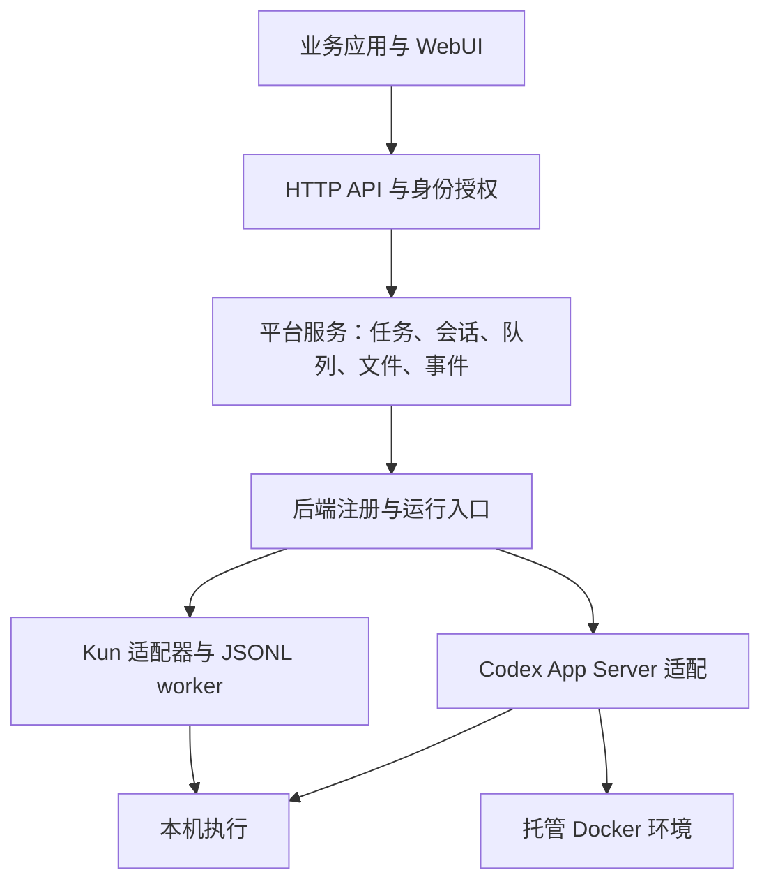
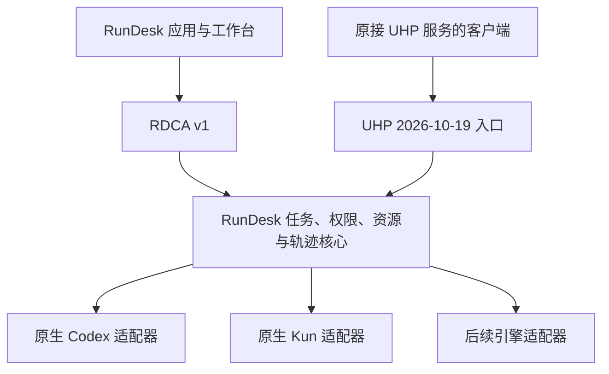

# RunDesk 系统架构

RunDesk 向应用提供持久任务与可检查的 Agent 执行过程。外部独立项目 Kun 和 Codex 是两个后端；模型 Provider、Kun 内部循环策略和操作系统执行环境分别建模。

平台保持独立，自身接口命名为 **RunDesk Control API（RDCA）**，入口为 `/api/v1`。本源码包也提供固定 UHP `2026-10-19` 的 `/v1` 入口，与 RDCA 复用任务、资源、权限和调试核心，不依赖 HarnessRouter。已实现的入口不等于完整协议兼容；具体覆盖与后端限制见 [UHP 服务](UHP.md) 和 [API 定位与兼容计划](ARCHITECTURE.md#api-position)。

## 三个使命与职责

| 面向人群 | RunDesk 的职责 | 保留在外部的职责 |
| --- | --- | --- |
| 企业 Agent 落地团队 | 观测运行轨迹、模型交互、工具调用和失败，提供调试工作台 | Harness 执行模型与工具循环；业务方验收任务效果 |
| 应用开发者 | 连接 APP 与 Harness，集中准备资源和运行环境，提供任务、进度与产物接口 | APP 实现领域功能、业务工具与专业结果审阅 |
| Harness 开发者与研究者 | 基于可检查证据进行调试、回放、分叉和对照实验 | 引擎实现实验能力；不支持的能力明确缺失 |

这里的 Harness 指承载 Agent 模型与工具循环的运行系统，当前接入 Codex 与独立 Kun。运行预设绑定经过配置的环境；Skills、MCP、插件和镜像按实际后端能力组合。原生插件在本版只支持检查与来源识别，不承诺自动安装，见 [运行预设](APPLICATION-RUNTIME-PRESETS.md) 和 [插件边界](NATIVE-PLUGINS.md)。

## 平台身份与 API 命名

RunDesk 是独立的 Go 控制平台与调试工作台，不以 HarnessRouter 服务、源码、数据库或运行时为依赖。自身 API 命名为 **RunDesk Control API（RDCA）**，当前版本为 RDCA v1，继续使用 `/api/v1`。这里的 v1 是 RunDesk 自有契约版本，不是 UHP 的版本。

RDCA 覆盖任务、会话、文件、事件、资源配置、执行环境与调试，并继续遵守各接口的身份、作用域和归属限制。现有契约见 [API v1](API-V1.md)；RDCA 命名本身不改变路径、请求字段、响应结构或错误与幂等语义。

[UHP](https://unifiedharnessprotocol.org/) 是固定版本的线协议参考；[HarnessRouter](https://github.com/HarnessRouter/harnessrouter) 是设计参考及迁移客户端的原服务，不是 RunDesk 的第三个必需执行后端。RunDesk 在 `/v1` 提供 UHP 入口，完整兼容仍需补足已记录的语义差异并完成真实客户端回归。

## 当前分层

这张图描述当前实现：Kun 尚未接入托管 Docker，远程 worker 也尚未实现。

| 层 | 主要职责 | 代码入口 |
| --- | --- | --- |
| 应用契约 | RDCA `/api/v1` 与 UHP `/v1`、认证/归属、幂等、结构化错误 | `internal/app/api_v1.go`、`uhp_http.go`、`application_keys.go` |
| 平台服务 | 应用/实例、任务队列、会话、审批入口、文件、事件投影 | `internal/app`、`internal/store` |
| 任务契约 | 提交、查询、取消；队列管理与资源检查独立接口 | `internal/app/task_control.go` |
| 资源契约 | 身份、版本、归属、绑定、路径解析、权限声明 | `internal/resource`、`internal/app/resources.go` |
| 后端入口 | 注册内置后端、能力描述、准入、运行和停止分派 | `internal/app/backends.go`、`runtime_services.go`、`runtime_host.go` |
| Codex 连接 | App Server JSON-RPC、原生线程/轮次、恢复和事件 | `internal/rpc`、`internal/app/runtime_codex.go` |
| HTTP 观测 | 原协议直通、旁路字节副本、有界队列与采集完整性 | `internal/observeproxy`、`internal/app/observation.go` |
| Kun 连接 | 外部 worker 启动、真实版本/能力握手、请求关联、事件补取 | SDK `client`、`internal/app/runtime_kun.go` |
| Kun 公共契约 | 消息、客户端与纯校验；不链接执行内核 | `third_party/kun-sdk` |
| 外部 Kun 执行内核 | 模型/工具循环、控制、快照、动作账本、回放、Skill 快速路径 | 独立 Kun 项目 `internal/engine`、`cmd/kun` |
| 执行环境 | 本机进程、Codex 容器与挂载/租约 | `internal/app/execution.go` 及 environment 文件 |
| 界面与调试 | 统一工作台、轨迹/模型交互、只读问答工具和 Kun 高级面板 | `internal/web`、`internal/debugapi`、`internal/tracequery` |

## 共享任务核心与两个服务入口

UHP 入口中的 RunDesk 扮演 server；应用是 client。向下如何驱动引擎由 RunDesk 的原生适配器负责。采用 UHP 不要求向 HarnessRouter 发请求，也不把 UHP 当作 Kun 的内部 JSONL 协议。

两个入口复用同一套任务调度、身份与归属校验、执行状态和轨迹存储。幂等提交通过公共任务准入事务保存协议回执；等待和重试响应仍按各自协议实现。协议层负责验证、映射和输出，不能分别维护两套运行循环或终态权威。幂等命名空间绑定调用身份和协议入口：RDCA 保留规范化请求校验，UHP 按同一身份/键查回首次提交，不重新执行新请求体。相同 Key 不表示不同协议中的请求自动等价；客户端应持久保存并复用原请求。

任务提交回执、会话中的一次执行、UHP response 和原生引擎 turn 并非名称替换。实施时需明确 ID 映射、接收与终态、续接、并发、取消竞争和错误语义，并以契约测试验证。已有 RDCA 客户端继续使用自身语义，不为 UHP 改写历史回执。

## 三类身份

- **Application** 表达业务接入身份，绑定专用 Instance；应用凭据同时约束实例、项目和 scopes。
- **Instance** 保存后端、模型默认值、权限、Skills/MCP 和执行环境配置。可同时存在 Kun 与 Codex 实例。
- **Session** 保存后端归属与对话历史，含多个 Run。Task 关联一次运行及其 Session；普通新任务创建会话，支持续接的入口可在原会话提交新 Task。更换实例后端不会迁移历史 Session，也不自动重发历史任务。

任务接收、运行状态与业务评测是三个不同事实。RDCA 队列接收返回 202；完成看任务/会话终态，质量看明确规则及证据。幂等规则按协议入口区分：RDCA 核对规范化请求，UHP 按调用身份与 Key 查回原提交；两者不共享幂等命名空间。业务 taskId 只是标签。

## 后端契约与扩展边界

基于 v0.52.0 的重构采用独立执行模块加公共服务。`RuntimeBackend` 定义 `Info/Prepare/Run/Stop`；Codex 与 Kun 各自实现原生执行流程，构造时注入生命周期、资源、权限及原生扩展接口，不接收或保存 `*Manager`。`runtime_host.go` 集中组装宿主服务；Kun 事件插入、游标推进和 Session 投影仍由宿主事务统一提交。注册表未知类型直接失败，不回退 Codex。

`TaskControl` 供 API 使用，`QueueControl` 与 `TaskResourceControl` 分别控制管理和检查能力。共同授权、队列额度、输入持久化及生命周期仍由平台负责，准入中的引擎专属检查移入各自的 `Prepare`。`PolicyService` 保存平台权限声明，由后端映射到真实执行策略；实际运行时回报与声明仍分别记录。

这些是内部模块契约，尚不是可动态加载的插件 SDK。已有原生配置/审批/恢复/实验辅助逻辑继续通过专用宿主接口提供；`Input` 和连接句柄仍含现有引擎专属数据。添加第三个后端需实现模块、配置、环境和能力测试，不能仅登记名称。配置来源与资源引用规则见 [资源契约](RESOURCE-CONTRACTS.md)。

能力目录描述“实现支持”；`setup/environment` 检查已配置实例的本机前置条件；会话 DebugService 进一步区分 supported 与 available。不能把目录中的 step 能力理解为每个后端、每种运行状态均可调用。

## 平台资源与调试边界

Skills、MCP、插件、权限、工作区与原生状态的身份、版本及作用域绑定属于 RunDesk 平台服务。v0.52.0 重构版已提供 `resource.Catalog/Bindings/Resolver`、`PolicyService` 和实际运行路径接入。清单投影现有权威配置，Skills/MCP/plugin 标记声明来源与不支持项；不把目录声明当成已加载清单，不公开凭据或主机路径。每次准入记录资源元数据，原生执行仍由独立后端转换配置并回报实际状态。

资源内容版本冻结、统一目录写入管理和所有后端的插件装载仍需后续扩展。当前清单不是完整配置备份；Codex 原生配置与 Skill 目录可由外部工具修改，其版本明确标记为 live。见 [资源契约](RESOURCE-CONTRACTS.md)。

来自 UHP 入口的新运行生成 RunDesk 原生任务与轨迹关联；经过授权，可在工作台或 RDCA 调试接口中查看其工具参数、结果、错误和实际采集到的模型交互。UHP 标准输出与 RunDesk 调试扩展分别表达，不要求标准客户端理解 Kun 专属操作。

调试能力以实际引擎、当前状态、授权和已记录证据为准。没有模型正文采集就不能显示完整模型请求；没有断点、单步、快照或分叉能力就不能宣称支持。Codex HTTP 观测继续是默认关闭的原协议直通采集，不转变为统一模型 API。

当前 Kun 仍拥有模型与工具循环、journal、检查点和分叉。把 Kun 进一步拆成决策内核、由 RunDesk 执行动作，是独立的后续设计，不是 UHP 的既有要求，也不属于本版变更。每次运行只有一个循环负责人；将来若拆分，运行分叉需协调决策状态与平台工作区、记录和副作用边界。

## 轨迹和调试

共同事件信封为宿主 `id/sessionId/time/direction/method/data`。`data` 保留后端原生载荷；统一投影呈现运行、步骤、审批、异常与统计，不推测模型隐藏推理。宿主事件 ID 与 Kun worker sequence 分别固定，不能互换。缺失证据保持未知。

Codex 提供宿主记录与原生协议暴露的检查；经过内置直通代理的模型请求另外保存原始字节副本，不改变供应商 API 或模型语义。查询层按会话与固定事件范围读取摘要、元数据和字节分页，供工作台和独立诊断共用；不会让模型执行任意 SQL。Kun 可进一步固定模型输入输出、工具证据、上下文快照、条件断点和单步控制。回放/分叉、评测、Skill 验证属于显式扩展，不以最低公共能力限制 Kun，也不为 Codex 伪造内部状态。

网络转发不等待数据库持久化；采集资源不足或写入失败只影响可观测性，记录丢失标记与计数，不重发业务请求。正文和队列均有明确上限；元数据与正文完整性、当前控制状态与历史检查范围分别建模。部署与认证覆盖见 [统一调试与采集](UNIFIED_DEBUGGING.md)。

HTTP 采集默认关闭，`Session.observeHTTP` 保存会话偏好，服务启动参数仅决定新建 Codex 会话的默认值。代理在处理已启用线程时懒启动；关闭路径跳过观测配置发现和路由覆盖。偏好修改不打断当前执行，下一轮提交自动重连并恢复原 thread；保存值、待应用标记和已确认配置代理的状态分开记录。

Hybrid 重算只回放录制工具结果；Live 分叉使用当前工具真实执行。K4 受限快速路径复用审批、预算和账本，守卫失败保留已完成结果后回退。结果未知的副作用不会自动重发，取消不等于回滚。详见 [调试](TRACE.md#debug-overview)。

Kun 自然语言诊断使用宿主提供的 `__trace_mcp` 只读证据桥，固定来源与事件上界由宿主约束；Kun 不导入 RunDesk 数据库或轨迹查询实现。SDK 独立版本、协议版本和引擎版本分别管理，详见 [拆分与兼容](KUN-SEPARATION.md)。

## 进程与持久化

Go 主服务嵌入 WebUI，SQLite 保存平台对象与事件。每个加载的 Kun 会话使用独立 worker 和执行数据库，通过序号补取与去重关联宿主投影；两库没有跨进程原子事务。默认全局并发 4，队列、直接会话与恢复共用额度，等待审批也占额度。

任务检查返回平台状态与资源引用，可显式导出为 `<data>/tasks/<taskId>/resources.json`。文件是带观察时间的可重建视图，修改它不会修改任务；不会把原生会话数据库或工作区复制进去。新个人产物默认登记原文件引用，只有显式快照保留独立版本；历史托管副本继续兼容。见 [任务资源视图](TASK-RESOURCES.md) 和 [文件库](PERSONAL-FILES.md)。

配置通过 revision 防止覆盖；向导将默认实例和 setup 状态原子保存。重启恢复排队元数据，已开始或结果未确认的执行进入中断/待核对状态，不靠跨后端自动重试修复。

## 参考项目

[HarnessRouter](https://github.com/HarnessRouter/harnessrouter) / [UHP](https://unifiedharnessprotocol.org/) 提供应用驱动完整 Agent 运行时、可复用后端配置和契约测试的参考。RunDesk 保持独立 Go 平台，Kun 是外部独立引擎；本包不包含 HarnessRouter 实现。UHP 适配的是 RunDesk 对外提供服务的协议，当前 `/v1` 入口有明确覆盖范围，不向下依赖 HarnessRouter，也不声明完整一致性。采用的设计参考与 PiG 来源统一登记在 [UPSTREAM](UPSTREAM.md)。
