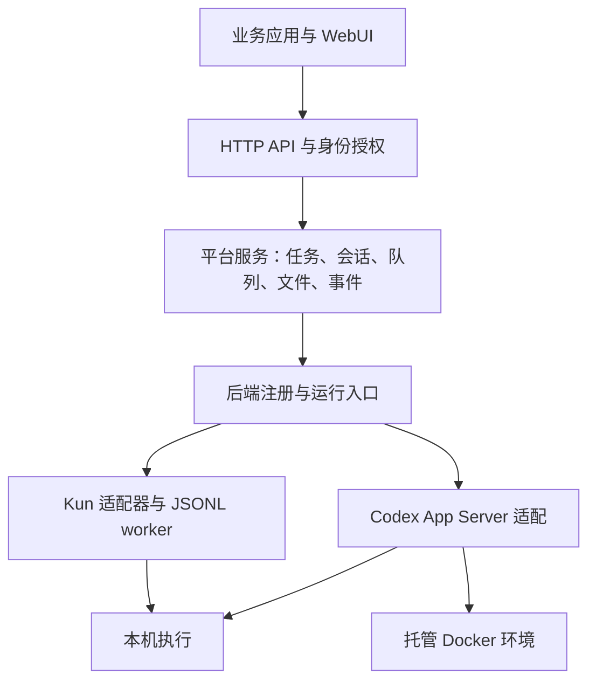

# RunDesk 系统架构

RunDesk 向应用提供持久任务与可检查的 Agent 执行过程。Kun 和 Codex 是两个后端；模型 Provider、Kun 内部循环策略和操作系统执行环境分别建模。

## 当前分层

这张图描述当前实现：Kun 尚未接入托管 Docker，远程 worker 也尚未实现。

| 层 | 主要职责 | 代码入口 |
| --- | --- | --- |
| 应用契约 | `/api/v1`、认证/归属、幂等、结构化错误 | `internal/app/api_v1.go`、`application_keys.go`、`http.go` |
| 平台服务 | 应用/实例、任务队列、会话、审批入口、文件、事件投影 | `internal/app`、`internal/store` |
| 后端入口 | 注册内置后端、能力描述、运行和停止分派 | `internal/app/backends.go` |
| Codex 连接 | App Server JSON-RPC、原生线程/轮次、恢复和事件 | `internal/rpc`、`internal/app/manager.go` |
| Kun 连接 | worker 启动、协议握手、请求关联、事件补取 | `internal/adapters/kun`、`internal/app/kun.go` |
| Kun 执行内核 | 模型/工具循环、控制、快照、动作账本、回放、Skill 快速路径 | `internal/kun`、`cmd/kun` |
| 执行环境 | 本机进程、Codex 容器与挂载/租约 | `internal/app/execution.go` 及 environment 文件 |
| 界面与调试 | 业务操作、轨迹、公共只读查询、Kun DevTools | `internal/web`、`internal/debugapi`、`internal/tracequery` |

## 三类身份

- **Application** 表达业务接入身份，绑定专用 Instance；应用凭据同时约束实例、项目和 scopes。
- **Instance** 保存后端、模型默认值、权限、Skills/MCP 和执行环境配置。可同时存在 Kun 与 Codex 实例。
- **Session** 保存后端归属与对话历史，含多个 Run。一个排队 Task 关联独立 Session；更换实例后端不会迁移历史 Session，也不自动重发历史任务。

任务接收、运行状态与业务评测是三个不同事实。队列接受返回 202；完成看任务/会话终态，质量看明确规则及证据。幂等键绑定调用身份与请求内容，业务 taskId 只是标签。

## 后端契约与扩展边界

`AgentBackend` 当前抽出了运行、停止和静态能力目录。注册表未知类型直接失败，不回退 Codex；`Manager.run` 和停止流程按会话后端选择适配器。共同授权、队列额度、输入持久化及生命周期仍由平台负责。

这是内部接口整理的第一层，尚不是可动态加载的插件 SDK。配置类型仍覆盖 Kun/Codex；连接、审批、恢复及 Kun 实验准备仍有专用实现。添加第三个后端需要补配置、生命周期、环境与契约测试，不能仅登记名称。后续继续将这些行为逐步收敛，保持现有 API 和副作用语义。

能力目录描述“实现支持”；`setup/environment` 检查已配置实例的本机前置条件；会话 DebugService 进一步区分 supported 与 available。不能把目录中的 step 能力理解为每个后端、每种运行状态均可调用。

## 轨迹和调试

共同事件信封为宿主 `id/sessionId/time/direction/method/data`。`data` 保留后端原生载荷；统一投影呈现运行、步骤、审批、异常与统计，不推测模型隐藏推理。宿主事件 ID 与 Kun worker sequence 分别固定，不能互换。缺失证据保持未知。

Codex 提供宿主记录与原生协议暴露的检查；Kun 可进一步固定模型输入输出、工具证据、上下文快照、条件断点和单步控制。回放/分叉、评测、Skill 验证属于显式扩展，不以最低公共能力限制 Kun，也不为 Codex伪造内部状态。

Hybrid 重算只回放录制工具结果；Live 分叉使用当前工具真实执行。K4 受限快速路径复用审批、预算和账本，守卫失败保留已完成结果后回退。结果未知的副作用不会自动重发，取消不等于回滚。详见 [调试](DEBUG.md)。

## 进程与持久化

Go 主服务嵌入 WebUI，SQLite 保存平台对象与事件。每个加载的 Kun 会话使用独立 worker 和执行数据库，通过序号补取与去重关联宿主投影；两库没有跨进程原子事务。默认全局并发 4，队列、直接会话与恢复共用额度，等待审批也占额度。

配置通过 revision 防止覆盖；向导将默认实例和 setup 状态原子保存。重启恢复排队元数据，已开始或结果未确认的执行进入中断/待核对状态，不靠跨后端自动重试修复。

## 参考项目

[HarnessRouter](https://github.com/HarnessRouter/harnessrouter) / [UHP](https://unifiedharnessprotocol.org/) 提供应用驱动完整 Agent 运行时、可复用后端配置和契约测试的参考。RunDesk 保持独立 Go 平台与 Kun 内核；当前没有引入其源码，也没有实现或声明 UHP 兼容入口。采用的设计参考与 PiG 来源统一登记在 [UPSTREAM](UPSTREAM.md)。
