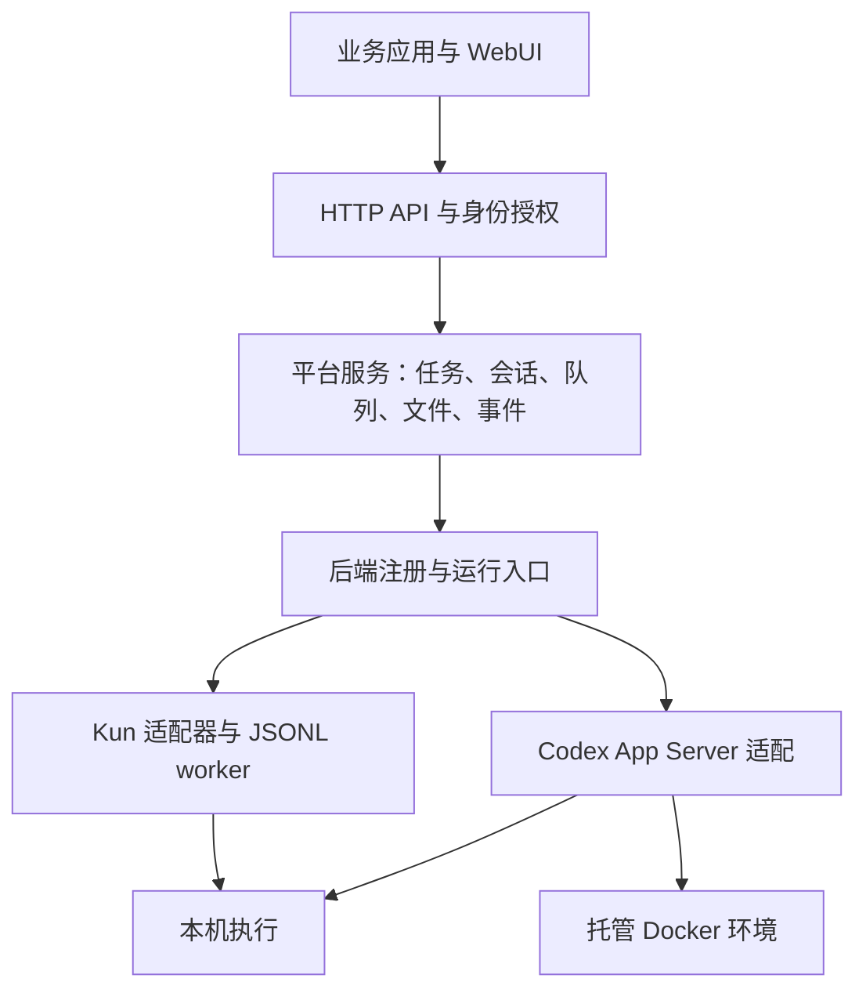

# RunDesk 系统架构

RunDesk 向应用提供持久任务与可检查的 Agent 执行过程。外部独立项目 Kun 和 Codex 是两个后端；模型 Provider、Kun 内部循环策略和操作系统执行环境分别建模。

平台保持独立，自身接口命名为 **RunDesk Control API（RDCA）**，现有入口为 `/api/v1`。后续 UHP 服务入口与 RDCA 复用同一运行和调试核心，供原接其他 UHP 服务的应用切换到 RunDesk；不以 HarnessRouter 为依赖。该入口尚未实现，见 [API 定位与兼容计划](API-STRATEGY.md)。

## 当前分层

这张图描述当前实现：Kun 尚未接入托管 Docker，远程 worker 也尚未实现。

| 层 | 主要职责 | 代码入口 |
| --- | --- | --- |
| 应用契约 | `/api/v1`、认证/归属、幂等、结构化错误 | `internal/app/api_v1.go`、`application_keys.go`、`http.go` |
| 平台服务 | 应用/实例、任务队列、会话、审批入口、文件、事件投影 | `internal/app`、`internal/store` |
| 任务契约 | 提交、查询、取消；队列管理与资源检查独立接口 | `internal/app/task_control.go` |
| 资源契约 | 身份、版本、归属、绑定、路径解析、权限声明 | `internal/resource`、`internal/app/resources.go` |
| 后端入口 | 注册内置后端、能力描述、准入、运行和停止分派 | `internal/app/backends.go`、`runtime_services.go`、`runtime_host.go` |
| Codex 连接 | App Server JSON-RPC、原生线程/轮次、恢复和事件 | `internal/rpc`、`internal/app/runtime_codex.go` |
| HTTP 观测 | 原协议直通、旁路字节副本、有界队列与采集完整性 | `internal/observeproxy`、`internal/app/observation.go` |
| Kun 连接 | 外部 worker 启动、真实版本/能力握手、请求关联、事件补取 | SDK `client`、`internal/app/runtime_kun.go` |
| Kun 公共契约 | 消息、客户端与纯校验；不链接执行内核 | `third_party/kun-sdk` |
| 外部 Kun 执行内核 | 模型/工具循环、控制、快照、动作账本、回放、Skill 快速路径 | 独立 Kun 项目 `internal/engine`、`cmd/kun` |
| 执行环境 | 本机进程、Codex 容器与挂载/租约 | `internal/app/execution.go` 及 environment 文件 |
| 界面与调试 | 统一工作台、轨迹/模型交互、只读问答工具和 Kun 高级面板 | `internal/web`、`internal/debugapi`、`internal/tracequery` |

## 三类身份

- **Application** 表达业务接入身份，绑定专用 Instance；应用凭据同时约束实例、项目和 scopes。
- **Instance** 保存后端、模型默认值、权限、Skills/MCP 和执行环境配置。可同时存在 Kun 与 Codex 实例。
- **Session** 保存后端归属与对话历史，含多个 Run。一个排队 Task 关联独立 Session；更换实例后端不会迁移历史 Session，也不自动重发历史任务。

任务接收、运行状态与业务评测是三个不同事实。队列接受返回 202；完成看任务/会话终态，质量看明确规则及证据。幂等键绑定调用身份与请求内容，业务 taskId 只是标签。

## 后端契约与扩展边界

基于 v0.52.0 的重构采用独立执行模块加公共服务。`RuntimeBackend` 定义 `Info/Prepare/Run/Stop`；Codex 与 Kun 各自实现原生执行流程，构造时注入生命周期、资源、权限及原生扩展接口，不接收或保存 `*Manager`。`runtime_host.go` 集中组装宿主服务；Kun 事件插入、游标推进和 Session 投影仍由宿主事务统一提交。注册表未知类型直接失败，不回退 Codex。

`TaskControl` 供 API 使用，`QueueControl` 与 `TaskResourceControl` 分别控制管理和检查能力。共同授权、队列额度、输入持久化及生命周期仍由平台负责，准入中的引擎专属检查移入各自的 `Prepare`。`PolicyService` 保存平台权限声明，由后端映射到真实执行策略；实际运行时回报与声明仍分别记录。

这些是内部模块契约，尚不是可动态加载的插件 SDK。已有原生配置/审批/恢复/实验辅助逻辑继续通过专用宿主接口提供；`Input` 和连接句柄仍含现有引擎专属数据。添加第三个后端需实现模块、配置、环境和能力测试，不能仅登记名称。配置来源与资源引用规则见 [资源契约](RESOURCE-CONTRACTS.md)。

能力目录描述“实现支持”；`setup/environment` 检查已配置实例的本机前置条件；会话 DebugService 进一步区分 supported 与 available。不能把目录中的 step 能力理解为每个后端、每种运行状态均可调用。

## 轨迹和调试

共同事件信封为宿主 `id/sessionId/time/direction/method/data`。`data` 保留后端原生载荷；统一投影呈现运行、步骤、审批、异常与统计，不推测模型隐藏推理。宿主事件 ID 与 Kun worker sequence 分别固定，不能互换。缺失证据保持未知。

Codex 提供宿主记录与原生协议暴露的检查；经过内置直通代理的模型请求另外保存原始字节副本，不改变供应商 API 或模型语义。查询层按会话与固定事件范围读取摘要、元数据和字节分页，供工作台和独立诊断共用；不会让模型执行任意 SQL。Kun 可进一步固定模型输入输出、工具证据、上下文快照、条件断点和单步控制。回放/分叉、评测、Skill 验证属于显式扩展，不以最低公共能力限制 Kun，也不为 Codex 伪造内部状态。

网络转发不等待数据库持久化；采集资源不足或写入失败只影响可观测性，记录丢失标记与计数，不重发业务请求。正文和队列均有明确上限；元数据与正文完整性、当前控制状态与历史检查范围分别建模。部署与认证覆盖见 [统一调试与采集](UNIFIED_DEBUGGING.md)。

HTTP 采集默认关闭，`Session.observeHTTP` 保存会话偏好，服务启动参数仅决定新建 Codex 会话的默认值。代理在处理已启用线程时懒启动；关闭路径跳过观测配置发现和路由覆盖。偏好修改不打断当前执行，下一轮提交自动重连并恢复原 thread；保存值、待应用标记和已确认配置代理的状态分开记录。

Hybrid 重算只回放录制工具结果；Live 分叉使用当前工具真实执行。K4 受限快速路径复用审批、预算和账本，守卫失败保留已完成结果后回退。结果未知的副作用不会自动重发，取消不等于回滚。详见 [调试](DEBUG.md)。

Kun 自然语言诊断使用宿主提供的 `__trace_mcp` 只读证据桥，固定来源与事件上界由宿主约束；Kun 不导入 RunDesk 数据库或轨迹查询实现。SDK 独立版本、协议版本和引擎版本分别管理，详见 [拆分与兼容](KUN-SEPARATION.md)。

## 进程与持久化

Go 主服务嵌入 WebUI，SQLite 保存平台对象与事件。每个加载的 Kun 会话使用独立 worker 和执行数据库，通过序号补取与去重关联宿主投影；两库没有跨进程原子事务。默认全局并发 4，队列、直接会话与恢复共用额度，等待审批也占额度。

任务检查返回平台状态与资源引用，可显式导出为 `<data>/tasks/<taskId>/resources.json`。文件是带观察时间的可重建视图，修改它不会修改任务；不会把原生会话数据库或工作区复制进去。新个人产物默认登记原文件引用，只有显式快照保留独立版本；历史托管副本继续兼容。见 [任务资源视图](TASK-RESOURCES.md) 和 [文件库](PERSONAL-FILES.md)。

配置通过 revision 防止覆盖；向导将默认实例和 setup 状态原子保存。重启恢复排队元数据，已开始或结果未确认的执行进入中断/待核对状态，不靠跨后端自动重试修复。

## 参考项目

[HarnessRouter](https://github.com/HarnessRouter/harnessrouter) / [UHP](https://unifiedharnessprotocol.org/) 提供应用驱动完整 Agent 运行时、可复用后端配置和契约测试的参考。RunDesk 保持独立 Go 平台，Kun 是外部独立引擎；当前没有引入其源码，也没有实现或声明 UHP 兼容入口。后续兼容的是 RunDesk 对外提供服务的协议，不是向下依赖 HarnessRouter。采用的设计参考与 PiG 来源统一登记在 [UPSTREAM](UPSTREAM.md)。
