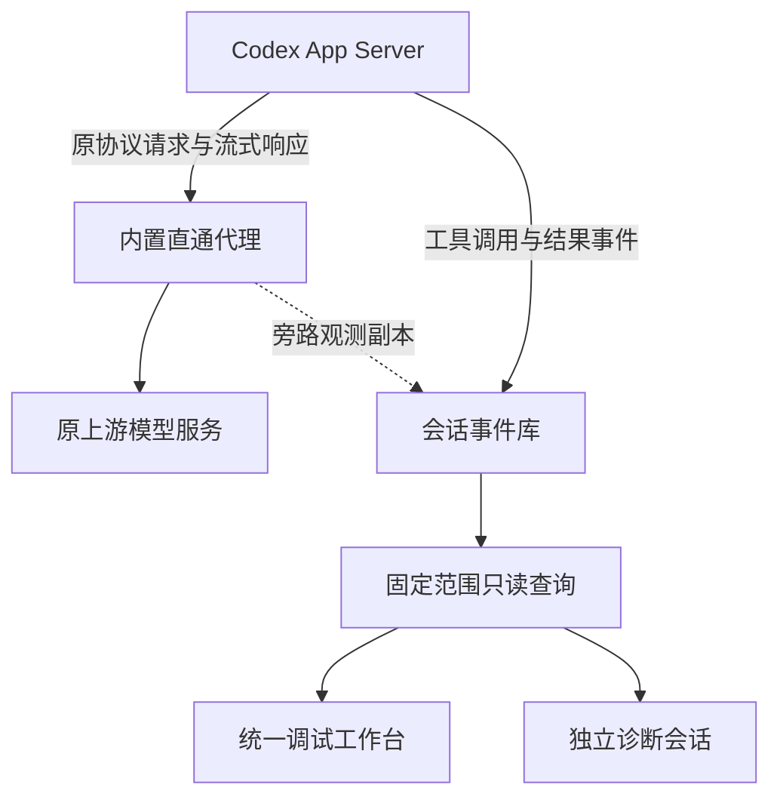

# 统一调试工作台与 Codex 观测

RunDesk 0.49.1 使用同一个调试工作台检查轨迹、结构化证据和 Kun DevTools。Codex HTTP 采集默认关闭，按会话保存开关。共同视图使用会话和固定宿主事件范围；Kun 的内部状态与控制继续按自身 run、sequence 和 revision 校验。合并入口不改变原任务的执行权限，也不让 Codex 获得 Kun 的单步能力。

## 采集和问答的数据来源



事件库仍是现有 SQLite `state.db`。模型交互以 `llm/exchange` 事件保存，保留请求、响应、时间、采集完整性和会话关联；查询层按会话、宿主事件上界及已记录的 runId 选择证据。请求正文保留为字节数据，结构化列表和元数据读取不需要将整个轨迹塞给诊断模型。

工具步骤沿用原生 Codex RPC 事件。完整事件保留已暴露的参数、结果、未知扩展字段和 JSON 大整数；界面预览只是导航。工具定义如果出现在真实模型请求的工具目录中，可以从该请求正文核对。没有请求采集或没有相应原生事件时，不补写推测的参数或 schema。

诊断会话固定来源会话和 `through`，通过只读工具分步查询，再引用宿主事件 ID 给出解释。新增 `trace_list_llm_requests`、`trace_read_llm_request`；外部 `rundesk debug-mcp` 对应 `debug_llm_requests`、`debug_llm_request`。查询本身不运行模型、工具或原任务，也不提供任意 SQL、shell 或数据库写入。原始正文和工具输出是待分析证据，不能作为诊断模型的新指令。

## 直通代理的边界

代理连接原来的上游，保留客户端的模型 API、路径、参数及业务请求/响应正文。它不转换 Responses / Chat Completions，不替换模型，不补写 prompt，不提供统一供应商接口，不增加模型重试、路由切换或结果缓存。上游使用独立 HTTP/1.1 连接，避免复用失效连接引起传输层自动重发；当前不提供上游 HTTP/2。HTTP 连接头按转发要求处理，保存的是应用字节而非逐包网络录制。

SSE 和 WebSocket 数据继续按实际传输顺序流动；观测副本记录读取或写入片段的顺序与时间。这些片段是观测器看到的字节块，**不是** HTTP 分块、SSE 事件或 WebSocket 消息边界。WebSocket 采集保留原始帧字节，包括客户端掩码，只在连接关闭后完成记录。持久连接可能跨轮次，因此其 run/thread/turn 归属留空，连接建立时的标签放在 `connectionStartLabels`，不能据此认定每个后续帧的轮次。

保存观测副本发生在传输之外。采集上限、队列压力和存储故障会导致证据不完整，不能触发模型请求重发。每次实际经过代理的请求独立记录；上游或 Codex 自己的重试可能产生多条请求。已开始但未完成的请求、进程突然终止、绕过代理的连接和旧会话不保证出现在列表中；列表为空不证明没有模型调用。

默认每个方向保留最多 16 MiB 正文，所有在途采集与待写入记录共用 64 MiB 正文内存预算；队列最多 128 条，每个方向最多 4096 段时间元数据。超过预算继续转发，保留部分标明截断；时间片段截断同样影响完整性。队列丢失会产生 `observation-loss` 标记并增加 `droppedRecords`；记录回调失败增加 `recordErrors`。正文的 `complete` 说明观察到了 EOF 或预期字节数，不证明模型消息或业务任务完整完成。

## 启动与 Codex 接入

正常启动默认关闭 Codex HTTP 采集；关闭的会话不为采集读取模型配置、发现上游或设置代理路径。代理只在首次处理已启用会话的 Codex 线程时按需启动，默认监听随机宿主回环端口：

```bash
./bin/rundesk --data ./data
# 可选：让此后新建的 Codex 会话默认开启采集
./bin/rundesk --data ./data --observe-http=true
```

`--observe-http` 是**新建 Codex 会话的默认值**，不覆盖已有会话保存的设置，也不强制整个服务统一开关。只配置 `--observe-listen` / `--observe-advertise` 不会开启采集。Kun 保留自身的原生模型证据，不允许开启这个 Codex 专用开关。

在会话菜单选择“HTTP 采集设置”，或进入调试工作台的“LLM 请求 / 响应”视图，切换当前 Codex 会话的采集设置。也可调用会话 PATCH：

```http
PATCH /api/v1/sessions/{sid}
Content-Type: application/json

{"observeHTTP": true}
```

关闭时将 `true` 改为 `false`。设置持久保存；重启服务、改变 CLI 默认值或浏览器刷新不会覆盖已有设置。已有采集记录仍可查询，关闭不会删除历史。

界面分别显示保存值与当前连接状态。如果保存响应丢失或报错，点击“核对采集状态”读取服务端结果；此操作不提交新任务，也不推进已固定的轨迹历史范围。

修改在**下一轮提交**生效，包括当前空闲的会话。运行期间保存新偏好不会取消、重发或改写当前请求；当前执行继续使用已应用设置。下一轮开始前，RunDesk 自动重连 App Server 并 resume 原来的 Codex thread，再应用保存值，不创建新的业务会话。若在运行中关闭采集，当前已走代理的请求仍可能在结束后入库。

| 字段 | 含义 |
| --- | --- |
| `Session.observeHTTP` | 当前保存的会话偏好 |
| `observation.pending` | 新偏好是否尚待下一轮提交应用 |
| `observation.appliedEnabled` | 原生线程已确认配置观测代理；开启偏好但不支持采集时仍为 `false`，不证明请求已经入库 |
| `observation.state` | `pending` 为待应用；应用后通过 configured/observed/disabled/unavailable 等状态说明采集情况 |
| `observation.captureId` | 可选的当前观测连接代次；旧连接延迟入库的记录不能将新连接标记为已采集 |

只有已启用的会话在创建或恢复 Codex 线程前进行观测所需的原生配置读取，并在线程内覆写模型地址，使它经过代理直达原上游；不永久修改用户配置或替换 `model_provider`。其他 provider 字段、认证和协议仍由 Codex 处理。

| Codex 配置 | 接入方式与边界 |
| --- | --- |
| 自定义 provider | 使用已选 provider 的显式 `base_url`；ID 须能安全表示为原生配置覆盖路径 |
| 内置 `openai`，显式 `openai_base_url` | 使用该原生配置键进行线程级覆盖，不覆写保留的 provider 定义 |
| 本机内置 provider，没有显式地址 | 读取 `account/read`，确认 API Key 或普通 ChatGPT 账户对应的原生默认上游 |
| Docker 内置 provider | 要求显式 `openai_base_url`，不以宿主环境猜测容器认证路由 |
| 工作区特殊路由、未知账户类型、未确认的 `OPENAI_BASE_URL` 环境覆盖 | 保留原连接，标记 HTTP 采集缺口 |

真实 Codex CLI 0.158.0 的自定义 provider HTTP 和内置 provider 原生 WebSocket 地址覆盖已通过本地合成凭据/上游测试。本轮使用 `environments: []` 创建持久线程，基线与线程级覆盖四项均通过；跨进程 `thread/resume` 在当前环境仍超时，尚未完成动态验证。恢复时重新读取当前配置、不会恢复旧代理 URL 的行为已核对该精确版本源码，并由 Manager 子进程测试覆盖开关时序；这不等同于完整真实 CLI 生命周期验收。**没有使用真实 ChatGPT 登录凭据完成线上模型调用验收**。当前结果与边界见 [验证记录](VALIDATION.md)。

无法安全发现上游或 Docker 网络尚未配置时，原模型连接继续执行，会话的 `observation` 状态和 `llm/capture-status` 事件标记覆盖缺口。关闭采集时状态为 `disabled`，仍保留原有 App Server 协议事件。`configured` 只表示设置了线程路由；第一条实际观测写入后变为 `observed`，仍需检查每条记录完整性。记录失败时为 `degraded`，存储恢复后重试丢失标记，不重发模型调用。尚未完成的连接不会提前出现在已保留列表中。

Docker 内的 Codex 不能访问宿主回环端口。需要选择容器可达的私有监听地址和同一端口，并显式提供容器使用的代理 origin，例如：

```bash
./bin/rundesk --data ./data \
  --observe-listen 0.0.0.0:3211 \
  --observe-advertise http://host.docker.internal:3211
```

该示例只配置代理网络地址，仍需开启目标 Codex 会话的采集开关；也可另加 `--observe-http=true` 为新会话设置默认值。示例要求 Docker bridge 网络和有效的 `host.docker.internal` 宿主映射；在目标部署确认端口可达。`--observe-advertise` 仅接受 HTTP origin，不接受凭据、路径、query 或 fragment。代理只为已注册上游提供随机 capability 路径，不提供任意目标的通用 forward proxy；仍应只将端口开放给所需的私有网络。不要将生成的内部路径用于公开链接。

`--demo` 没有真实模型请求。旧记录、未经过代理的连接以及真实 Codex 没有暴露的内容不会补回。完成一次实际模型调用后，再在 HTTP 面板检查请求、响应和采集标记。

## 如何读取完整 Request / Response

先列出当前保留范围，再使用返回的 `eventId` 读取详情，并在后续查询保留同一个 `through`：

```text
GET /api/v1/sessions/{sid}/debug/query?kind=llm_requests&limit=25
GET /api/v1/sessions/{sid}/debug/query?kind=llm_request&through=500&eventId=480&section=metadata
GET /api/v1/sessions/{sid}/debug/query?kind=llm_request&through=500&eventId=480&section=request&offset=0&limit=4000
GET /api/v1/sessions/{sid}/debug/query?kind=llm_request&through=500&eventId=480&section=response&offset=0&limit=4000
```

| 查询部分 | 用途 | 分页单位 |
| --- | --- | --- |
| `metadata` | 方法、URL、状态、头、时间、关联和采集标记；不带正文 | 不分页，offset 只能为 0 |
| `request` / `response` | HTTP 正文字节 | 字节；默认 4000，最大 16000 |
| `websocket_upstream` / `websocket_client` | 升级后两个方向的保留字节 | 字节；默认 4000，最大 16000 |
| 上述正文部分加 `_chunks` | 采集片段顺序、时间、偏移等元数据 | 片段；默认/最大 50 |
| `websocket_upstream_messages` / `websocket_client_messages` | 只读解码后的消息列表，包含原始帧范围和完整性 | 消息；默认/最大 50 |
| `websocket_upstream_payload` / `websocket_client_payload` | `messageIndex` 选定消息的载荷 | 字节；默认 4000，最大 16000 |

正文的 `bodyBase64` 是该段精确字节；`text` 只供 UTF-8 显示，跨页中文字符和无效字节可能显示替代字符。完整恢复时逐页解码 `bodyBase64` 并拼接字节，直到 `hasMore=false`。HTTP 正文不会自动解压；存在 `Content-Encoding` 时需按记录头解释保留的编码字节。不能把单页预览或拼接后的 `text` 当成字节级原文。

WebSocket 可在查询侧移除掩码、合并 continuation 片段，再查看模型 `response.create` 与响应事件的 JSON 文本。解码不参与网络转发，原始帧仍保留。ping/pong/close 以独立条目显示，消息列表按首个帧的顺序排列；`messageIndex` 为 0–4095，默认 0，仅用于两种 `_payload` 部分。读取最多 32 MiB 原始帧，聚合解码载荷最多 16 MiB、4096 条消息、16384 帧。非法帧、尾部不完整和解码上限均显式标记。

压缩 WebSocket 消息保留去掩码后的压缩字节，并标记 `compressed` / 不支持解压，当前不实现 permessage-deflate 的跨消息上下文解码；不会将压缩数据冒充 JSON 文本。消息的 `complete` 仅说明保留字节能构成完整消息，不表示整个连接或模型任务完整。

检查 `complete`、`incomplete`、`truncated`、`captureLoss`、正文错误和采集字节数后，才能判断这次记录能否覆盖整个交互。分页读取完毕只表示读完**已保留**的部分。请求缺失 runId 时只按会话查看，不猜测它属于某一轮；传入 runId 只匹配记录中的明确标签。

列表默认 25、最多 50 条，元数据最大 512 KiB，查询期限 8 秒。公共调试 HTTP 响应仍限制为 4 MiB，应用与成员沿用原会话归属和 `read` 权限。宿主事件 ID、runId 和 Kun worker sequence 不能互换。

## 凭据与保留数据

转发数据不能被脱敏器修改。保存副本中的认证头按规则脱敏，并记录哪些头被处理；正文仍保留实际字节，可能包含提示词、业务资料、工具输入输出或模型响应。头部已脱敏不表示正文没有敏感内容。应按照业务数据要求保护原有数据目录和调试读取凭据。

本版不会恢复旧版本没有保存的 HTTP 正文，也不能采集模型服务没有返回的内部状态。正常业务返回、某个工具成功和业务目标达成需要分别核验。

## news2douyin 联调

选择实际研究对应的 RunDesk 会话和 runId，先核对业务提交回执，再检查模型请求、MCP 参数、结果与新闻侧保存的来源/报告。新闻应用复用同一会话时，每轮应通过其提交回执里的 `rundesk_run_id` 对应 RunDesk 轮次，不仅依靠会话首次的 taskId。

HTTP 观测可以确认真正发送给模型的工具目录与上下文；Codex RPC 可以确认向宿主暴露的工具调用和结果；新闻侧报告、来源和 claim 则证明其业务持久化内容。三个来源都需要明确记录引用，不能把工具返回成功直接当成搜索质量或最终报告完整性的证明。

验证范围见 [VALIDATION](VALIDATION.md)，只读 API 与权限细节见 [DEBUG-SERVICE](DEBUG-SERVICE.md)。真实部署的 Codex 版本、认证和容器网络路径仍需在目标环境运行一次实际任务核验。
